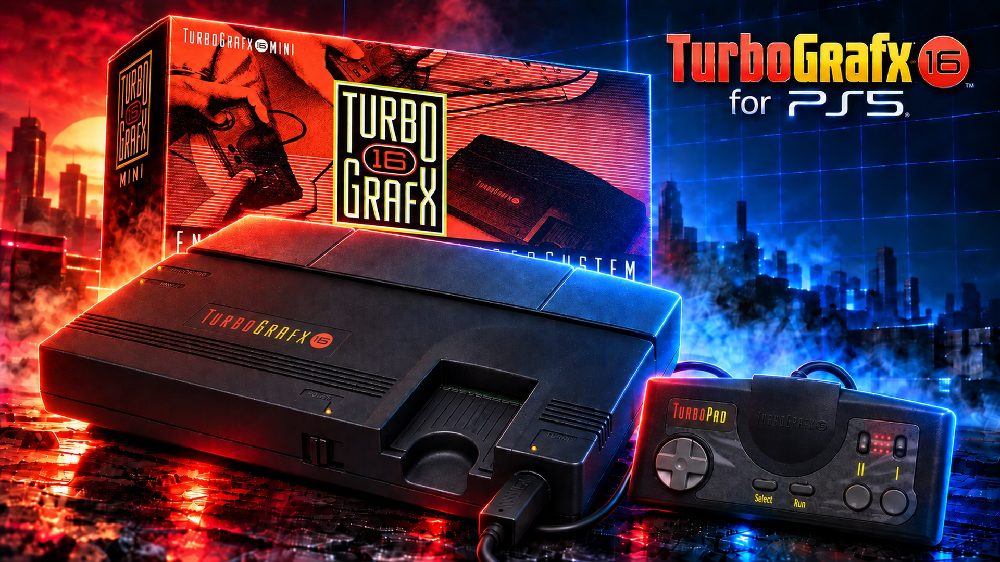

# Beetle PCE PS5



[Beetle PCE](https://github.com/libretro/beetle-pce-libretro) -- Mednafen's accurate PC Engine emulator, the
"pce" module, through its libretro port -- running on a jailbroken PS5 as a **native home-screen app** with its own
icon and background. One app plays the whole family:

| System | Files | Needs (in `/data/pce/bios/`) |
|---|---|---|
| PC Engine / TurboGrafx-16 / CoreGrafx HuCards | `.pce` (also inside a `.zip`) | nothing |
| SuperGrafx | `.sgx` (or `.pce`: a SuperGrafx game the game list knows starts as one) | nothing |
| CD-ROM² / TurboGrafx-CD | `.cue` (+ its tracks), `.chd`, `.ccd`, `.toc`, `.m3u` | a System Card: `syscard3.pce` (best), `syscard2.pce` or `syscard1.pce` |
| Super CD-ROM² | the same | `syscard3.pce` (System Card 3.0) |
| Arcade CD-ROM² (Arcade Card) | the same | `syscard3.pce`; the Arcade Card itself is emulated (on by default) |
| Games Express CDs | the same | `gexpress.pce` (picked by the core when the disc is one) |

TurboGrafx-16 HuCards dumped with their data lines reversed (every byte's bits in the opposite order) are found and
put right when they start. CD games started without a System Card say on the screen which file is needed and where
it goes. The tracks a `.cue` names, the discs an `.m3u` lists and the `.img`/`.sub` of a `.ccd` are not listed as
games of their own.

**Inside the emulator, to access the main menu press L3 + R3.**

The PS5 layer is the one of Genesis Plus GX PS5, Snes9x PS5 and FBNeo PS5, which follow the layout of PS5SX2 (the
PCSX2 port):

- `ps5/coreorbis` holds `main-boot.cpp`, the `orbis-shims/` and `include-orbis/`;
- `ps5/frontend` holds the user interface, the 3D game shelf and the glue to the core;
- `ps5/proto/native` builds and signs `eboot.bin`;
- `ps5/installer` is the installer and helper payload.

Everything outside `ps5/` is Beetle PCE's source (the original README is
[README-Beetle-PCE.md](README-Beetle-PCE.md)), with a few changes listed in [The core](#the-core). The frontend
drives the core through its libretro interface and plays the part RetroArch plays on a PC.

> **Status (1.0.1):** builds with the ps5-payload-dev SDK into a signed native app, and passes 291 host tests, which
> run the same code (the Beetle PCE core included) on Linux with the PS5 calls simulated: a test HuCard (made by
> `ps5/tests/make_test_rom.py`) is played through the whole chain -- the shelf, the pad, the core, the video and
> sound output -- as a PC Engine card, a SuperGrafx card, a card with a copier header, a reversed TurboGrafx-16
> dump, and as the System Card of a CD game. **It has not been run on a PS5 yet**, and no commercial game has
> been tried with this port: please report what works and what doesn't. If something fails, the logs in
> `/data/pce/logs/` say where.

## The core

Of the three Mednafen-based PC Engine cores libretro has, this port uses **Beetle PCE** (the "pce" module):

| Core | Systems | Accuracy |
|---|---|---|
| **Beetle PCE** (used) | PC Engine, SuperGrafx, CD-ROM², Super CD-ROM², Arcade Card | sub-instruction CPU timing, the 16-sprites-per-line limit, all sprite sizes, dot-clock aspect ratios, the Street Fighter II mapper, Populous's RAM |
| Beetle PCE Fast | PC Engine and CDs, no SuperGrafx | trades accuracy for speed |
| Beetle SuperGrafx | PC Engine Fast with the SuperGrafx added | the same as Fast |

The fast cores exist for weak machines; the PS5's CPU runs the accurate one many times over (on a PC like the
PS5's, with the build's flags: about 700 frames a second for one core, where 60 are needed), so there is nothing to
gain from them, and Beetle PCE is the one that covers every system in one core.

Beetle PCE follows Mednafen 1.29.0. What [Mednafen's releases](https://mednafen.github.io/releases/) changed for the
PC Engine since, up to 1.32.1, is brought in, and a few things are fixed or tuned for the PS5:

- **Mednafen 1.32.1:** the PSG's channel 1 follows writes to the LFO frequency register (it didn't until another
  register was written); a HuCard image too big for the extended Street Fighter II mapper (over 8.5 MiB) is
  refused instead of running past its tables.
- **Speed:** Mednafen's sound resampler (OwlResampler) has SSE and AVX loops that the libretro build never enabled
  (it took a third of the emulation's time in its plain C loop). They are on (`ARCH_X86`), with the CPU features
  taken from the build's target (Zen 2): the core runs about 60% faster.
- **`.m3u` playlists** didn't load at all (the loader never reported success), and two `.m3u` naming each other
  recursed until the stack ran out: fixed.
- A HuCard given as data (from a `.zip`) lost its extension, so a `.sgx` card inside a zip didn't start as a
  SuperGrafx game: fixed. The pad type (2 or 6 buttons) now applies at once, not only at the next game. A small
  leak in the core's messages is fixed.

The changes are in the repository's history, one commit each.

## How it works

The PS5 gives the controller only to the app in front, so Beetle PCE runs as a native app opened from its icon,
and the payload you send is its installer:

| Piece | What it is | In PS5SX2 |
|---|---|---|
| `eboot.bin` in `/data/homebrew/PPSA99925/` | **the emulator itself**, a native app opened from its icon | PCSX2 (PPSA99203) |
| `sce_module/libc.prx` | the C runtime module every native app carries | the same file, byte for byte |
| `BeetlePCEPS5.elf` (payload) | the **installer**: installs or updates the app, then stays running as the **helper** | PS5SX2Installer.elf + PS5SX2Helper.elf |

When it opens, the app asks the helper to let it out of its sandbox; without that an app sees neither `/data`
nor USB drives. The request is the one PS5SX2 makes:

- **Who is asked, in order:** the Beetle PCE helper (127.0.0.1:9093), then etaHEN (9028) and the daemon on port
  9069.
- **If nobody answers:** the app carries a copy of the helper (`BeetlePCEPS5-helper.elf`), sends it to the ELF
  loader (127.0.0.1:9021) and asks again. So the icon keeps working after a reboot, as long as the ELF loader
  runs.
- **What the helper allows:** only title PPSA99925. It gives the process the system's root folder and uid 0, as
  elfldr does for payloads. No other app is touched.

Beetle PCE PS5 only uses `/data/pce/`, `/data/homebrew/PPSA99925/` and its own `/user/appmeta/PPSA99925/`. It sits
next to Genesis Plus GX PS5 (PPSA99921, helper port 9088), Snes9x PS5 (PPSA99922, port 9089), FBNeo PS5
(PPSA99924, port 9092) and PS5SX2 (PPSA99203) without touching them.

## Versions

Every release carries its version in the file name: `BeetlePCEPS5-v1.0.1.elf` and `pce-ps5-v1.0.1-src.zip`
(`make dist`). When updating, replace the old ELF with the new one in your autoload or Payload Manager. In this
README, "`BeetlePCEPS5.elf`" always means the current release's ELF.

**1.0.1:** the interface in five languages (English, Spanish, Portuguese (Brazil), French, German: Settings,
SYSTEM, Language); the debug logs are off by default.

**1.0:** the first release.

## Updates

The app updates itself from this repository's GitHub releases, as Genesis Plus GX PS5 does:

- **Settings, SYSTEM, Updates** shows the version you have and what to do: *Check now*, *Install 1.1 (20 MB)*,
  the download and install progress, then *Installed: restart* (Cross opens the new version).
- Once a day, when the app starts, it checks by itself; when a newer version is out, a notification says so.
  Nothing is installed without you choosing *Install*.
- The helper does the work, with its own HTTPS (Mbed TLS, certificates checked). It asks
  `api.github.com/repos/MisterTemaki/beetlepcePS5/releases/latest` for the newest release and takes its asset
  `BeetlePCEPS5-v<version>-PPSA99925.zip`.
- The zip is checked before anything is written: its size and SHA-256 against what GitHub gives, then every file
  against the zip's own list (`PPSA99925/manifest.sha256`). Each file is written beside the old one, then all are
  put in place with `eboot.bin` last; files the new version no longer has are removed, and the home screen's
  copy of the art is refreshed. If anything fails before that, nothing has changed.
- Only `/data/homebrew/PPSA99925/` changes. Games, saves and settings (`/data/pce/`) aren't touched.
- **Your autoload:** the app updated this way is newer than the ELF in your autoload. The older ELF sees that and
  leaves the app alone (its notification says so), and its helper still serves the newer app. Put the new ELF in
  your autoload when you can: a new version may come with a new helper.

For a release, `make dist` builds the zip (`build/dist/BeetlePCEPS5-v<version>-PPSA99925.zip`, the app folder
stored without compression, with its manifest). Attach it to the GitHub release, tagged `v<version>`, next to the
ELF. The same zip is what the homebrew catalog lists.

## Language

Settings (Triangle on the shelf), **SYSTEM**, **Language**: **English** (the default), **Español**, **Português
(Brasil)**, **Français**, **Deutsch**. The change applies at once, to every menu and message, and is kept in
`pce-ps5.ini` (`language=0` to `4`). The logs stay in English, and so do the notifications sent before the settings
are read (the covers downloaded at start) or by the helper (a new version available). Game names, the PS5's and the
PC Engine's button names, the System Cards' and the shaders' names are not translated.

## Requirements

- A jailbroken PS5 with **kstuff** (or kstuff-lite) and an **ELF loader** on port 9021: elfldr, etaHEN, or the
  one PS5 Payload Manager uses.
- **ShadowMountPlus**, so the icon appears on the home screen (the same one PS5SX2 uses).
- Your own games, and a System Card image for CD games. None are included.

## Install and play

1. **Send `BeetlePCEPS5.elf`** with PS5 Payload Manager, or from a PC on the same network:
   ```sh
   nc -q0 PS5_IP 9021 < BeetlePCEPS5-v1.0.1.elf
   ```
   It installs the app in `/data/homebrew/PPSA99925/` (`eboot.bin`, `sce_module/libc.prx`, `param.json`, the
   icon and the backgrounds), shows **"Beetle PCE PS5 1.0.1 installed. Open it from the Beetle PCE PS5 icon on the
   home screen."** and stays running as the helper.
2. **Open the Beetle PCE PS5 icon.** The game shelf appears and the controller works.
3. **Copy your games** to their system's folder, over FTP for example. The app makes the folders on its first
   start:

   | System | Games in | Your covers in |
   |---|---|---|
   | PC Engine / TurboGrafx-16 | `/data/pce/roms/PCEngine` | `/data/pce/covers/PCEngine` |
   | SuperGrafx | `/data/pce/roms/SuperGrafx` | `/data/pce/covers/SuperGrafx` |
   | PC Engine CD / TurboGrafx-CD | `/data/pce/roms/PCEngineCD` | `/data/pce/covers/PCEngineCD` |

   On a USB drive the same layout goes under `pce/roms` at the drive's root (`/mnt/usb0/pce/roms/PCEngine`...).
   Subfolders inside them are fine (`roms/PCEngineCD/Ys Book I & II (USA)/`). The game's system comes from its
   extension, so a game left directly in `roms/` or in another folder is still found. A `.cue` must sit next to
   its tracks. The System Card goes to `/data/pce/bios/`.

Tip: put `BeetlePCEPS5.elf` in your autoload, as PS5SX2 recommends for its payloads.

**Updating:** send the new `BeetlePCEPS5.elf` once. It compares every app file with the copy it carries and
rewrites only what changed; each file is written to a temporary file and then renamed, `eboot.bin` last. A deleted
or damaged icon is put back the same way. A second copy sent while the helper is already running only installs
and exits.

**If "Beetle PCE PS5 has no access to /data" appears:** no helper answered and the ELF loader wasn't running. Send
`BeetlePCEPS5.elf` and open the icon again.

| Folder | Contents |
|---|---|
| `/data/pce/roms/<system>` | your games: `PCEngine`, `SuperGrafx`, `PCEngineCD` |
| `/data/pce/bios` | the System Cards (`syscard3.pce`...) and `gexpress.pce` |
| `/data/pce/saves` | the backup RAM, one file per game and folder per system (`saves/PCEngineCD/<game>.srm`, 2 KiB; Populous's card: 32 KiB), written within 3 seconds of a change and when the game closes |
| `/data/pce/states` | save states, one folder per system: `states/PCEngine/<game>.state1` to `.state10` |
| `/data/pce/covers/<system>` | downloaded covers and your own, one folder per system (the same names as in `roms/`); `covers/` itself keeps `wanted.txt` and `crc-cache.txt` |
| `/data/pce/logs` | `boot.log` (the app), `installer.log` (installer/helper), `helper.log` (the helper the app starts), and the previous session's `.prev.log` files |
| `/data/pce/pce-ps5.ini` | the menu settings |

### The System Cards (CD games)

A PC Engine CD game starts through a System Card, the HuCard that held the CD unit's BIOS. Copy the image of yours
to `/data/pce/bios/` under its usual name:

| File | Card | Plays |
|---|---|---|
| `syscard3.pce` | Super CD-ROM² System Card 3.0 (Japan) | CD-ROM², Super CD-ROM², and Arcade CD-ROM² with the Arcade Card |
| `syscard3u.pce` | TurboGrafx-CD Super System Card 3.0 (USA) | the same |
| `syscard2.pce` / `syscard2u.pce` | System Card 2.0 / 2.1 | CD-ROM² only |
| `syscard1.pce` | System Card 1.0 | CD-ROM² only |
| `gexpress.pce` | Games Express card | the Games Express CDs (the core picks it for those discs) |

- **System Card (CD games)** in the settings is **Auto** by default: the best card in the folder, in the order of the
  table (3.0 first). Choose one to force it; if the chosen file isn't there the game doesn't start and says so.
- Most games, Super CD-ROM² and Arcade CD ones included, want **System Card 3.0**. If a game doesn't start with
  one card, try another (choose it in the settings).
- The **Arcade Card** (the PC Engine Duo's RAM card for the Arcade CD-ROM² games) is emulated and on by default;
  games that don't use it don't see it.
- The backup RAM (the "file cabinet" where CD games save) is kept per game (`saves/PCEngineCD/<game>.srm`), already
  formatted, so games can save at once.

### The home-screen app

```
/data/homebrew/PPSA99925/
  eboot.bin              Beetle PCE (a native app, signed as PS5SX2's is), with the helper inside
  sce_module/libc.prx    the native app's C runtime (the same as PS5SX2's and ps5-native-app-boilerplate's)
  sce_sys/param.json     title "Beetle PCE PS5", ID PPSA99925
  sce_sys/icon0.png      the icon (512x512; ps5/app/sce_sys/icon0.png in the source)
  sce_sys/pic0.dds       the home-screen background while the icon is selected (3840x2160, BC7)
  sce_sys/pic1.dds       the launch background (the same image)
```

The icon is the project's official art, `ps5/app/sce_sys/icon-source.png`: a PC Engine pad under the "Beetle PCE for
PS5" title; `icon0.png` is that image at 512x512. The background -- the large image behind the icon when Beetle PCE
PS5 is selected on the home screen -- is the project's background art, `ps5/app/sce_sys/background-source.png`
(3840x2160: a TurboGrafx-16, its box and its pad under the "TurboGrafx-16 for PS5" title), encoded to
`pic0.dds`/`pic1.dds` as BC7 by `ps5/tools/make_art.py` with bc7enc_rdo (as ps5-native-app-boilerplate's
`tools/prepare-assets.sh --background` does). To use your own art, replace those files and rebuild. For another
title ID: `make ps5 TITLE_ID=XXXX00000`.

**Home-screen art:** ShadowMountPlus copies the art in `sce_sys` (icon, backgrounds, `param.json`) to
`/user/appmeta/PPSA99925/` only when it first registers the title, and the system keeps the art it saw at that
moment. The installer keeps that folder current on every update, but if the title was registered before the art
changed, register it again once: select **Beetle PCE PS5** on the home screen, press **OPTIONS**, choose
**Delete** (your games, saves and covers in `/data/pce/` stay), then send `BeetlePCEPS5.elf` again.

## The game shelf and covers

The start screen is a 3D shelf of game covers, like PS5SX2's and Genesis Plus GX PS5's, with the author's line under
the wordmark: **github.com/MisterTemaki**.

- **All your games at once:** the shelf gathers the games in `/data/pce/roms` (its system folders) and on USB
  drives (`pce/roms`), subfolders included, sorted by name. Each game's line says its system and region.
- **One system at a time:** **Up / Down** switch between "All games" and each system that has games (PC Engine,
  SuperGrafx, PC Engine CD). The shelf remembers the last one.
- **Official names:** a HuCard is identified by its file name or, when that doesn't match, by its CRC32, looked up
  in a table built into the app (No-Intro, from libretro-database: 491 PC Engine / TurboGrafx-16 entries and the
  SuperGrafx ones; Redump names for 495 CD games, matched by file name).
  - The CRC is tried on the whole file, then without a 512-byte copier header, then -- for a reversed
    TurboGrafx-16 dump -- on the card put right.
  - HuCards and SuperGrafx cards are searched together: a SuperGrafx game saved as `.pce` is named, covered and
    started as one.
  - Loose names (`r-type.pce`) are recognised too.
  - CRCs are cached in `covers/crc-cache.txt`, so each card is read once; a zipped card's CRC comes from the zip's
    directory, and each zip's system is remembered, so a big library on a USB drive isn't opened zip by zip at
    every start. "Looking for games..." counts the games found, then shows a bar while they are identified.
- **Automatic covers, in the background:** box art comes from
  [libretro-thumbnails](https://github.com/libretro-thumbnails) (each system's `Named_Boxarts`) over HTTPS, the
  way Genesis Plus GX PS5 gets its own:
  - the **helper** downloads them while you use the app, with HTTPS of its own (Mbed TLS, the server's certificate
    checked against Mozilla's list of certificate authorities, one connection kept for all the downloads). The
    app lists the missing covers in `/data/pce/covers/wanted.txt`, and the ones around the selection in
    `covers/priority.txt` (fetched first); each cover replaces its card on the shelf as it lands. The top right
    corner shows "Downloading covers in the background... N left". The helper keeps going while the app is
    closed.
  - Covers are saved in their system's folder, `covers/<system>/<name>.png` (`covers/PCEngine/R-Type (USA).png`),
    and never downloaded twice. A cover the server doesn't have is marked (`.missing`) and only looked for again
    after 30 days; **Square** forces a new try.
  - Without a network nothing is tried and the shelf works the same.
- **Your own covers:** a `.png` or `.jpg` named after the ROM file, in `/data/pce/covers/<system>/`
  (`covers/PCEngine/R-Type.png` for `roms/PCEngine/R-Type.pce`), in `covers/` itself, or next to the ROM, takes
  priority over downloads.
- **No cover:** the game gets a card with its title and system.
- **Turning downloads off:** Settings, "Download covers".

### Downloading all the covers yourself

To fill the shelf without the console downloading anything (an offline PS5, or a big library), download each
system's whole cover set from [libretro-thumbnails](https://github.com/libretro-thumbnails) on a PC:

| System | All covers at once (zip) | Browse | Copy the images to |
|---|---|---|---|
| PC Engine / TurboGrafx-16 | [master.zip](https://github.com/libretro-thumbnails/NEC_-_PC_Engine_-_TurboGrafx_16/archive/refs/heads/master.zip) | [Named_Boxarts](https://github.com/libretro-thumbnails/NEC_-_PC_Engine_-_TurboGrafx_16/tree/master/Named_Boxarts) | `/data/pce/covers/PCEngine/` |
| SuperGrafx | [master.zip](https://github.com/libretro-thumbnails/NEC_-_PC_Engine_SuperGrafx/archive/refs/heads/master.zip) | [Named_Boxarts](https://github.com/libretro-thumbnails/NEC_-_PC_Engine_SuperGrafx/tree/master/Named_Boxarts) | `/data/pce/covers/SuperGrafx/` |
| PC Engine CD / TurboGrafx-CD | [master.zip](https://github.com/libretro-thumbnails/NEC_-_PC_Engine_CD_-_TurboGrafx-CD/archive/refs/heads/master.zip) | [Named_Boxarts](https://github.com/libretro-thumbnails/NEC_-_PC_Engine_CD_-_TurboGrafx-CD/tree/master/Named_Boxarts) | `/data/pce/covers/PCEngineCD/` |

1. Download the zip and unpack it on the PC. The covers are in its **`Named_Boxarts`** folder (the zip also has
   title screens and in-game shots: they are not used).
2. Copy the `.png` files from `Named_Boxarts` (not the folder itself) to that system's `covers/` folder, over FTP
   for example. Copying only the covers of the games you have saves space.
3. Open the app: games recognised by name or CRC pick their cover up at once, and nothing is downloaded for them.

Notes:

- The files keep their official names (`R-Type (USA).png`); the app looks for exactly that name, with the
  characters `` & * / : ` < > ? \ | " `` replaced by `_` as in the repository. `boot.log` lists the name it found for
  each game (`[games] ... -> "<name>"`).
- A few `.png` files in the repository are git links: a small text file holding the name of another cover. In the
  zip they may come out as text, not images; copy the cover they name under that file's name instead.
- One cover: `https://raw.githubusercontent.com/libretro-thumbnails/<repository>/master/Named_Boxarts/<name>.png`
  (spaces as `%20`).

The shelf is drawn by the CPU in real 3D perspective (each cover a quad turned about the vertical axis, drawn
column by column with bilinear filtering, mipmaps and anti-aliased edges, split across several cores).

## Controls

**Inside the emulator, to access the main menu press L3 + R3.**

**On the shelf**

| Button | Does |
|---|---|
| Left / Right (D-pad or stick) | change game (hold to speed up) |
| Up / Down | change system (All games, PC Engine, SuperGrafx, PC Engine CD) |
| L1 / R1 | skip 10 games |
| Cross | play |
| Triangle | settings |
| Square | download this game's cover again (the cover it has stays until the new one has arrived) |
| OPTIONS | quit Beetle PCE PS5 (asks first) |

**In a game:** by default, buttons by position, as RetroArch maps them for Beetle PCE. The PC Engine pad has II on
the left and I on the right, so II is Cross and I is Circle. Every button can be moved (Settings, **CONTROLS**).

| PS5 | PC Engine pad |
|---|---|
| Circle | I |
| Cross | II |
| Square | III (6-button pad) |
| Triangle | IV (6-button pad) |
| L1 | V (6-button pad) |
| R1 | VI (6-button pad) |
| touchpad click | Select |
| OPTIONS | Run |
| D-pad or left stick | D-pad |

| Combination | Does |
|---|---|
| L3 + R3 | pause menu: save / load state, slot, settings, reset, power cycle, back to the list, quit |
| L2 + Up / Down | save / load the state in the current slot |
| L2 + Left / Right | change slot (1-10) |
| hold R2 | fast forward (speed in the settings) |
| hold L2 + R2 | rewind |

Run + Select together is the PC Engine's reset in most games (Settings can block it).

**More players:** the multitap (the TurboTap) is plugged in by default: player 2 is the second signed-in user's
controller, up to four players (the PS5 reads four pads). The light bar shows the player.

**The 6-button pad** (Avenue Pad 6) is for the games made for it (Street Fighter II' Champion Edition and a few
CD fighting games): Settings, CONTROLS, **Pad**: 6 buttons. Most games want the usual 2-button pad, and some
misbehave with a 6-button one.

**Turbo:** the PC Engine pad's turbo switches. Settings, CONTROLS, **Turbo**:
- *III / IV switch I / II turbo*: on the 2-button pad, Square switches II's turbo on or off and Triangle I's (a
  message says which);
- *III / IV are turbo I / II*: Square and Triangle are II and I firing by themselves while held.
**Turbo speed** sets how fast (fast, medium, slow).

## Settings

Triangle on the shelf, or "Settings" in the pause menu. The line at the bottom of the screen explains the selected
setting.

- **Video:** **shader** (see [CRT shaders](#crt-shaders); CRT Easymode style by default), screen size (fit to
  screen, integer scale, stretch to 16:9), aspect ratio (TV -- the core works it out from the game's dot clock --,
  square pixels, 4:3, 6:5, 16:9), **colours** (RGB, or Composite: the colours of a TV fed by the console's
  composite output), picture edges (overscan: auto, hidden, shown), lines shown (all 240, 232 as Mednafen shows,
  224), smooth picture and scanlines (for the plain picture, with the shader Off), FPS counter.
- **Audio:** sound on/off, volume, the sound chip (auto, the first models' HuC6280, the later HuC6280A), and for CD
  games the volume of the CD's music, of the ADPCM voices and of the console's own sound (0 to 200%).
- **Emulation:** fast-forward speed (150% to unlimited), rewind on/off, remove the sprite limit, CPU overclock (2x
  to 4x, against slowdown; some games run too fast or break), CD speed (1x is the real drive; faster loads, some
  games break), System Card (auto or one), Arcade Card, block the Run + Select reset.
- **Controls:** the pad (2 or 6 buttons), the multitap, turbo and its speed, the button layout (for each PC Engine
  button, the PS5 button that presses it: Cross, Circle, Square, Triangle, L1, R1, OPTIONS, the touchpad, or none;
  **Default button layout** puts them back). L2, R2, L3 and R3 stay for the hot keys and menus, and the menus always
  use Cross / Circle.
- **Library:** download covers.
- **System:** **Language** -- see [Language](#language); **Debug logs** (Off by default since 1.0.1) -- see [Debugging](#debugging-logs-and-crashes); **Updates** -- see
  [Updates](#updates).

Changes apply at once, in the game too, and are saved in `pce-ps5.ini`; the sound chip, the System Card and the
Arcade Card apply from the next game. The settings go to the core as its libretro options (`pce_*`), so they behave
as in RetroArch.

## CRT shaders

Every game starts through a CRT shader -- **CRT Easymode style** unless you pick another one. Eleven shaders are
built in; they work on every system (PC Engine, SuperGrafx, CD) and only while a game is running (the shelf is drawn without them).

**How to use them**

1. **In a game:** press **L3 + R3** to open the pause menu and choose **Settings** (on the shelf: **Triangle**).
2. **Shader** is the first row: **Left / Right** (or **Cross**) go through the list. The picture behind the menu changes at once,
   so you can compare them on the game you are playing.
3. **Circle** closes the settings; the choice is saved and used for every game from then on.
4. **Off** gives the plain picture; with it, the "Smooth picture" and "Scanlines" options apply (with a shader on,
   the shader does that work).
5. The choice is kept in `/data/pce/pce-ps5.ini` as `shader=<number>` (the numbers below): you can also
   set it there by hand.

| `shader=` | Shader | Look | Weight | From |
|---|---|---|---|---|
| 0 | Off | the plain picture | -- | -- |
| 1 | **CRT Easymode style** (default) | flat screen, sharp, scanlines that widen on bright colours, aperture grille | medium | written for this port, after the look of EasyMode's crt-easymode |
| 2 | crt-lottes | curved screen, Gaussian beam, shadow mask, a little bloom | heavy | Timothy Lottes (public domain) |
| 3 | crt-lottes-fast | lighter Lottes: curved, 4-tap beam, aperture mask, tone mapping | medium | Timothy Lottes (public domain) |
| 4 | crt-1tap | very light, contrasty dynamic scanlines | light | fishku (CC0) |
| 5 | crt-2tap | crt-1tap with exact blending between two lines | light | fishku (CC0) |
| 6 | crt-hyllian-fast | sharp Catmull-Rom picture, strong scanlines, magenta/green dot mask | medium | Hyllian (MIT) |
| 7 | crt-nobody | curved screen with rounded corners, beam scanlines, magenta/green mask | heavy | Hyllian (MIT) |
| 8 | newpixie-mini | strongly curved TV, colour bleed, vignette, film tone | heavy | Mattias Gustavsson (Unlicense) |
| 9 / 10 | crt-blurPi-sharp / crt-blurPi-soft | light blur and screen-space scanlines (sharp or bilinear) | light | Oriol Ferrer Mesià (MIT) |
| 11 | monoCRT | a monochrome monitor (made for black-and-white pictures) | light | hunterk (public domain) |

Which to pick: **CRT Easymode style** for a sharp, flat arcade-monitor look; **crt-hyllian-fast** for stronger
scanlines and a visible dot mask; **crt-lottes** or **crt-nobody** for a curved TV; **crt-1tap / crt-2tap** when a
game should stay as light as possible.

They come from libretro's [slang-shaders](https://github.com/libretro/slang-shaders) (`crt/`), with their default
parameters. Why these: the PS5 build draws the picture with the CPU (there is no GPU driver for homebrew apps), so
only single-pass shaders are fast enough. They are the same eleven as in Genesis Plus GX PS5 (public domain, CC0,
Unlicense, MIT); "CRT Easymode style" is original code aiming at the look of crt-easymode. Multi-pass shaders (crt-royale, crt-guest-advanced,
the Mega Bezel...) need a GPU.

How they run: each shader is rewritten in C++ (`ps5/coreorbis/orbis-shims/ProsperoCrt.cpp`). What depends only on
a source line and a screen column (the horizontal filter) is computed once per source line; per screen pixel only
the vertical blend, the beam, the mask and a gamma table remain; curved screens use a per-pixel map built once per
picture size. The work is shared by up to six threads. Every minute in a game, `boot.log` says how long the shader
took per frame (`shader N ms`); if a heavy one (crt-lottes, crt-nobody, newpixie-mini) makes a game slow down,
pick a lighter one. Differences from the GPU versions: curved shaders read the horizontal filter between two
screen columns, monoCRT has no beam jitter.

## Picture and sound

- 1920x1080 output through `libSceVideoOut`, flipping on vsync. With little video memory it falls back to
  1280x720.
- The core runs one frame per call on the frontend's thread; its 32-bit frames come at the width of the game's dot
  clock (the 5, 7 and 10 MHz modes; a common multiple when a game mixes them on one screen), and are scaled to the
  TV with the aspect the core works out from that dot clock.
- Sound through `libSceAudioOut` at 48 kHz, on its own thread. The core's 44.1 kHz sound (Mednafen's resampler at
  quality 3, on its AVX loop; CD-DA and ADPCM mixed in) is resampled with a small rate control (within 0.5%) that
  keeps about 60 ms queued, so the PC Engine's 59.83 Hz plays without crackles on a 60 Hz TV, paced by the display.
- Fast forward runs several frames per display frame, muted; rewind keeps a snapshot every 3 frames (up to 192 MB:
  about two minutes for a HuCard game, 20 seconds for a CD game, whose state is bigger). The state's size is measured once per game, and the oldest snapshot's memory is
  reused, so rewinding costs little.

## Debugging (logs and crashes)

**Turning the logs on or off:** Settings (Triangle on the shelf, or L3 + R3 -> Settings in a game) -> **SYSTEM**
-> **Debug logs**. Off stops every log at once: the app writes nothing more to `boot.log` (its last line says the
logs were turned off) or to the console output, and the next starts -- the app, the installer and the helper --
write no log files at all; the files of earlier runs are left as they are (delete them over FTP if you want). On
starts again at once, adding to `boot.log`. The setting is `debug_logs=0` / `debug_logs=1` in
`pce-ps5.ini`; with no `debug_logs` line (the default since 1.0.1) they are off. Turn them on if you want to
report a problem: with them off there is no log to send, and no `== CRASH ==` report either.

If something fails, send the files in `/data/pce/logs/`: `boot.log` (the app), `installer.log` and
`helper.log`, plus the previous session's `.prev.log` files. They record every step:

- the sandbox request and who answered;
- the covers, one by one (`helper.log`: the background downloads; `boot.log`: the prefetch, when there is one);
- every `sceVideoOut*` call, and the picture's size and place on the screen;
- the controller handle and its first read;
- the games found, with their system and name;
- the core's own log (`[core] ...`: the disc's sheet, the System Card, its errors) and any missing System Card;
- frames per second, queued audio and underruns, and the shader's time per frame, every minute in a game.

If the app dies on a signal (the PS5's "Game or App Error" screen), a `== CRASH ==` block is written at the end
of `boot.log`: the signal, the address, the **stage** each part of the program was in (`stage[...]`: boot, shelf,
covers, emu, menu), and the return addresses, which map into `ps5/build/app/pce-pie.elf`.


## Known limitations

- **Not tried on a PS5 yet** (see the status at the top).
- The PS and Create buttons are not reported by `scePadReadState`, so Select is on the touchpad by default (and the
  button layout can't use them).
- Four players at most (the PS5's four pads), of the multitap's five. No PC Engine mouse, no Tsushin keyboard,
  although the core has them.
- An `.m3u` loads all its discs, but the frontend has no "change disc" yet: the first disc is the one inserted.
- No cheats, no HES music files (`.hes`), no PC-FX (another core).
- `.7z` archives are not read (`.zip` is, for HuCards); CD games are not read from inside a zip.

## Building

Requirements: the [ps5-payload-dev SDK](https://github.com/ps5-payload-dev/sdk) v0.42 or newer, clang/lld 18, and
g++ with ASan for the tests.

```sh
export PS5_PAYLOAD_SDK=/opt/ps5-payload-sdk
cd ps5
make ps5 -j$(nproc)              # build/ps5/BeetlePCEPS5.elf (installer + helper, with the app inside)
make send PS5_HOST=192.168.0.10  # sends it to elfldr (port 9021)
make dist                        # build/dist/BeetlePCEPS5-v<version>.elf, the release zip, the source zip
make app                         # only build/app/PPSA99925/, to copy by hand
make test                        # Linux builds (app, installer, helper) + 271 host tests (ASan/UBSan)
make bench                       # the core alone, -O3 for Zen 2: build/bench/pce-bench <card.pce> [frames]
```

The build has three stages:

1. `BeetlePCEPS5-helper.elf`, the helper alone.
2. `eboot.bin`: a PIE with the boilerplate's `app_crt.cpp`, the Beetle PCE core with its libretro port, and the
   frontend.
   - The core is compiled with the sources and defines of its `Makefile.common` (CHD through libchdr, Tremor for
     Ogg tracks, 32-bit colour), `-O3 -march=znver2`, and `ARCH_X86` for the resampler's SSE/AVX loops.
   - It is linked against the SDK's stubs and static libc++, with `ps5-pie.ld` + `ehframe.ld` and every symbol
     local.
   - Then it goes through `ps5-native-tool link` and `self --sign`, exactly like PS5SX2's `link-vk.sh`.
   - `libc.prx` goes with it, generated by `libc_builder` and checked against the published SHA-256
     (`ps5/proto/native/libc.prx.sha256`).
3. `BeetlePCEPS5.elf`, with the app folder built in.

## Source layout

- **`ps5/coreorbis/main-boot.cpp`**: the app's entry point (`eboot.bin`). Asks to leave the sandbox, brings up
  log, folders, video, sound and pads, starts the core, and hands over to the frontend on a thread with an 8 MiB
  stack. Exits through the system (`sceSystemServiceLoadExec("exit")`), as PS5SX2 does.
- **`ps5/installer/installer_main.cpp`**: `BeetlePCEPS5.elf` (installs the app and stays as the helper) and,
  built with `PCEPS5_HELPER_ONLY`, `BeetlePCEPS5-helper.elf`.
- **`ps5/coreorbis/orbis-shims/`**: the PS5 layer, shared with Genesis Plus GX PS5.
  - `ProsperoVideo.cpp`: `libSceVideoOut`, direct memory, two scan-out buffers, AVX2 tiling, the scaler (fit /
    integer / stretch, smoothing, scanlines) and the HUD overlay;
  - `ProsperoCrt.cpp`: the CRT shaders on the CPU, and their thread pool;
  - `ProsperoAudio.cpp`: `libSceAudioOut`, lock-free ring buffer, output thread;
  - `ProsperoInput.cpp`: `libScePad` + `libSceUserService`, several players, read from any thread;
  - `ProsperoJailbreak.cpp` / `ProsperoHelper.cpp`: both sides of the sandbox request and the covers list;
    `helper_data.cpp` builds the helper into the app;
  - `ProsperoInstall.cpp` + `install_data.cpp`: the app folder built into the installer, the install, and the
    `/user/appmeta` art;
  - `ProsperoUpdate.cpp`: the updates from GitHub's releases;
  - `ProsperoCrash.cpp`: the crash printer and stage markers;
  - `ProsperoNotify.cpp`: system notifications;
  - `orbis_paths.cpp`: `/data/pce`, USB drives and the logs.
- **`ps5/coreorbis/include-orbis/ProsperoSce.h`**: prototypes of the system functions (the SDK ships the import
  stubs but not the headers).
- **`ps5/frontend/`**:
  - `fe_emu.cpp`: the libretro frontend -- the core's environment calls (folders, options, log, the HuCard in
    memory: zips and reversed dumps), its video, audio and input callbacks, the pacing, the backup RAM, save states,
    rewind, the hot keys and the System Card choice;
  - `fe_games.cpp` + `data/nointro.tsv`: the library, systems, disc sheets (`.cue`, `.toc`, `.m3u`, `.ccd`), zips,
    reversed TurboGrafx-16 dumps and names (`ps5/tools/make_gamedb.py` makes the table);
  - `fe_shelf.cpp`, `fe_covers.cpp`, `fe_prefetch.cpp`, `fe_http.cpp`: the 3D shelf and covers;
  - `fe_coverworker.cpp`, `fe_coverfetch.cpp`: the helper's background downloads, and the fetch code the app and
    the helper share;
  - `fe_tlshttp.cpp`, `fe_mbedtls_config.h`, `data/cacert.pem`: the helper's own HTTPS client (sockets, Mbed TLS,
    Mozilla's CA list);
  - `fe_menu.cpp`, `fe_settings.cpp`, `fe_text.cpp`: menus, settings, text with PS5SX2's fonts;
  - `third_party/`: minizip (unzip.c, ioapi.c); Mbed TLS 3.6.7 (`mbedtls/`, its `include/` and `library/` as
    released).
- **`ps5/proto/native/`**: ps5-native-app-boilerplate's tools (BlackBearReloaded, GPL-3.0), taken from PS5SX2
  and PS5_Vulkan (mihawk-99): `ps5-native-tool`, `app_crt.cpp`, `ps5-pie.ld`, `libc_builder.cpp` and its
  manifests.
- **`ps5/app/sce_sys/`**: param.json, icon and backgrounds; **`ps5/tools/`**: the art (`make_art.py`), the game
  table, the release zip, the core benchmark (`core_bench.cpp`).
- **`ps5/host/sce_host.cpp`** and **`ps5/tests/`**: the PS5 functions implemented on Linux, the test HuCard
  (`make_test_rom.py`, a tiny hand-assembled HuC6280 program: a red screen, green while II is held, a byte written
  to the backup RAM), and the tests: picture and input as a PC Engine card, a SuperGrafx card, a card with a copier
  header and a reversed TurboGrafx-16 dump; a SuperGrafx game kept as `.pce`; CD games (no System Card, a stand-in
  System Card starting the disc, Auto and a chosen card, `.m3u`, tracks and `.img` hidden); save states, zip, sound
  latency, integer scale and scanlines, the shelf's tabs, the system folders, the controls (button layout, pad
  type, multitap, turbo), the CRT shaders, settings, fast forward and rewind, covers per system, install, helper
  and sandbox request, saves per system and the backup RAM (written when it changes, an erase too, not when
  unchanged), the edge cases (720p picture, Resume, FIFOs, disc sheets, long zip names and paths, a card too big
  for its mapper, the CRC cache, covers kept offline, downloads after a tab change), the debug logs setting, the
  helper's HTTPS, the updates and a big library's scan.

## License and credits

- **Beetle PCE** ([github.com/libretro/beetle-pce-libretro](https://github.com/libretro/beetle-pce-libretro)) and
  **Mednafen** (the Mednafen Team, [mednafen.github.io](https://mednafen.github.io/)): GPL-2.0-or-later (`COPYING`
  at the root). This port, its builds and their sources are under the GPL too: every binary is distributed with its
  complete source. The core's components keep their own licenses (libchdr, LZMA, zstd, zlib, Tremor: BSD-style /
  public domain). The Mednafen 1.32.1 changes come from [mednafen-git](https://github.com/libretro-mirrors/mednafen-git).
- **New code in `ps5/`**: MIT (each file says so), shared with Genesis Plus GX PS5, Snes9x PS5 and FBNeo PS5.
- **The home-screen idea** follows [PS5SX2](https://github.com/Swordpdf/PS5SX2) (Spyros): the PS5 layer's
  pattern (Prospero* shims, kernel toast, `/data` layout, the sandbox request, the cover prefetch and exiting
  through the system).
- **ps5-payload-dev SDK** (John Törnblom): toolchain, CRT, kernel access and import stubs (GPLv3+).
- **ps5-native-app-boilerplate** (BlackBearReloaded, GPL-3.0-or-later): `ps5-native-tool`, `app_crt.cpp`,
  `app_cpp_runtime.cpp`, `ps5-pie.ld` and the `libc.prx` generator, via PS5SX2 and PS5_Vulkan (mihawk-99).
- The VideoOut tiling and setup follow the SDK's SDL2 port (zlib license).
- **minizip** (Gilles Vollant): zlib license.
- **Mbed TLS** 3.6.7 ([github.com/Mbed-TLS/mbedtls](https://github.com/Mbed-TLS/mbedtls), the Mbed TLS
  contributors): Apache-2.0 (`ps5/frontend/third_party/mbedtls/LICENSE`).
- **Mozilla's CA certificate list** (`ps5/frontend/data/cacert.pem`, as packaged by
  [certifi](https://github.com/certifi/python-certifi)): MPL-2.0.
- **CRT shaders** from libretro's [slang-shaders](https://github.com/libretro/slang-shaders), rewritten for the CPU:
  crt-lottes and crt-lottes-fast (Timothy Lottes, public domain), crt-1tap and crt-2tap (fishku, CC0), monoCRT
  (hunterk, public domain), newpixie-mini (Mattias Gustavsson, Unlicense), crt-hyllian-fast and crt-nobody
  (Hyllian, MIT), crt-blurPi (Oriol Ferrer Mesià, MIT). Their notices are in `ps5/THIRD_PARTY_SHADERS.md`.
  "CRT Easymode style" is original code; the look it follows is EasyMode's crt-easymode.
- **stb_image / stb_image_resize2 / stb_truetype** (Sean Barrett): public domain or MIT.
- **UI fonts**, the same as PS5SX2's, in `ps5/frontend/assets/fonts/` with their licenses: Roboto Regular (Google,
  Apache 2.0), PromptFont (Yukari "Shinmera" Hafner, SIL OFL 1.1), Font Awesome Brands (Fonticons, Inc.; font
  SIL OFL 1.1, icons CC BY 4.0).
- **Icon and background:** the art chosen for the project: "Beetle PCE for PS5" for the icon
  (`ps5/app/sce_sys/icon-source.png`), "TurboGrafx-16 for PS5" for the home-screen background
  (`ps5/app/sce_sys/background-source.png`). NEC, PC Engine,
  TurboGrafx, SuperGrafx and CD-ROM² are trademarks of their owners, and PlayStation and PS5 of Sony Interactive
  Entertainment; this port is not affiliated with or endorsed by them.
- **Covers:** [libretro-thumbnails](https://github.com/libretro-thumbnails), downloaded on the console, not
  included. **Names and CRCs:** [libretro-database](https://github.com/libretro/libretro-database) (No-Intro,
  Redump).
- **Port:** [github.com/MisterTemaki](https://github.com/MisterTemaki); the PS5 app model follows PS5SX2.

---

Made in Brazil
